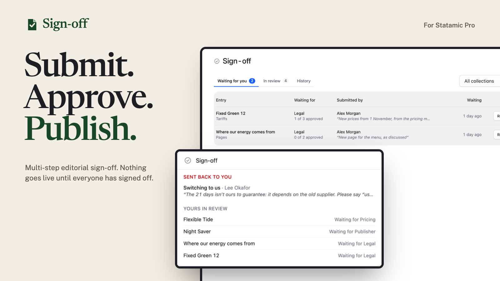
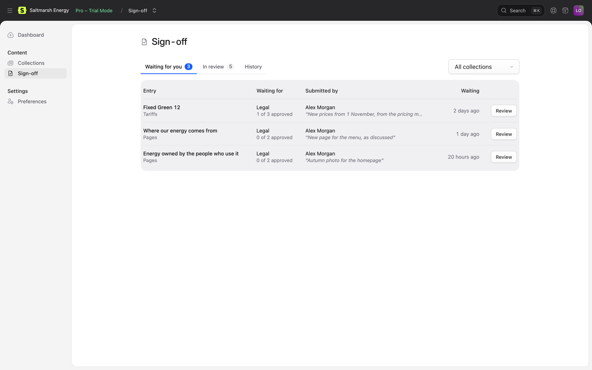
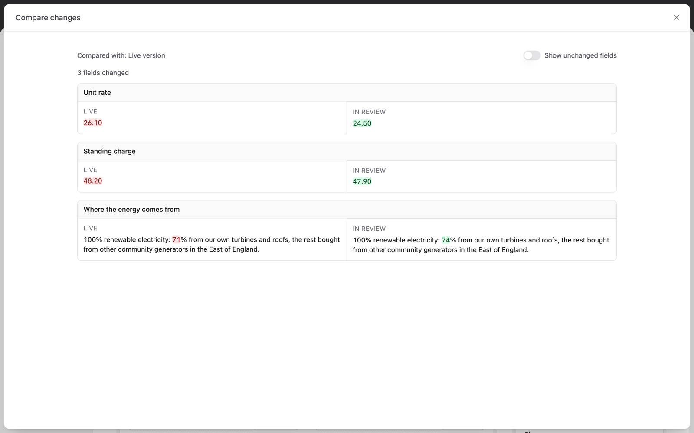
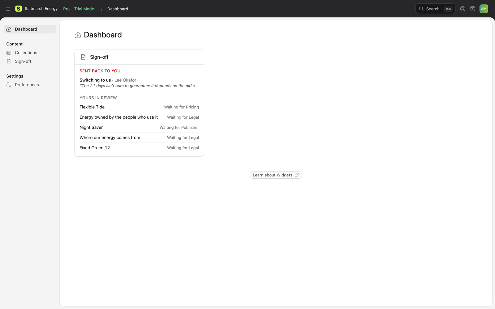

# Sign-off for Statamic

Multi-step editorial approval for Statamic Pro. Editors submit their changes, each step approves or sends them back with a reason, and nothing goes live until everyone has signed off.



Sign-off is built on Statamic's own revisions. Changes to a live page wait in its working copy, the live page stays as it is, and the last approval publishes through Statamic, so it's recorded in the entry's revision history like any other publish.

## Features

- **Steps per collection.** Legal, then Brand, then a Publisher. Each step is approved by roles, user groups, named users, a permission, or anyone who can publish. Collections without steps work as they always have.
- **Approve or send back.** Reviewers approve from the entry's ••• menu, or send it back with a reason the author sees in the sidebar. The last approval publishes.
- **Locked while in review.** An entry can't be changed while it's being reviewed, so what's approved is what goes live. Authors can withdraw it to make changes. If it changes anyway, it has to be submitted again.
- **See what changed.** Each field's old and new text side by side, with the changed words highlighted. Compare with the live page, or with what was submitted last time.
- **A queue for reviewers.** Content → Sign-off lists what's waiting for you, longest wait first, everything in review, and every round's outcome. A dashboard widget shows what needs you.
- **Emails.** Reviewers hear when an entry reaches their step; authors when it's sent back or signed off.
- **Ways round it, on the record.** People with the "Publish without sign-off" permission can still publish straight away, for urgent fixes. It's recorded in the entry's sign-off history. Taking a page down doesn't need sign-off, unless you want it to.
- **Set up in the Control Panel.** Steps, approvers and rules can be changed at Tools → Addons → Sign-off → Settings, or in a config file if you prefer.
- **Checks your setup.** A collection without revisions, a role that doesn't exist: people who can fix it are told in the Control Panel, and `php please sign-off:check` fails in your deploy.
- **For developers.** Events at every step, a PHP API, and flat-file or database storage.

| What's waiting for you | Comparing changes | The dashboard widget |
| --- | --- | --- |
|  |  |  |

The screenshots are from Saltmarsh Energy, a made-up energy co-operative. **[Try the demo](https://github.com/1994limited/sign-off-statamic-demo)**: it runs locally in a few commands, with five people and a week of work in progress, and no licence needed.

## Requirements

- Statamic 6 **Pro**, PHP 8.3 or later.
- Revisions turned on, for the site and for each collection that needs sign-off.

Sign-off adds approval steps on top of Statamic Pro's revisions and publish permissions; without Pro, entries are published as usual.

## Installation

```bash
composer require 1994/sign-off-statamic
php artisan vendor:publish --tag=sign-off-config
```

Turn revisions on in `.env`, and in the settings of each collection that needs sign-off:

```env
STATAMIC_REVISIONS_ENABLED=true
```

List the collections and their steps in `config/sign-off.php`:

```php
'collections' => [
    'pages' => [
        'steps' => [
            ['handle' => 'legal', 'title' => 'Legal', 'approvers' => ['roles' => ['legal']]],
            ['handle' => 'publisher', 'title' => 'Publisher', 'approvers' => 'publishers'],
        ],
    ],
],
```

Then check it:

```bash
php please sign-off:check
```

See [Installation](docs/installation.md) for the dashboard widget, the database driver and email.

## Documentation

Everything else is in [the documentation](docs/README.md):

- [Installation](docs/installation.md) and [configuration](docs/configuration.md)
- [How sign-off works](docs/how-it-works.md): steps, the lock, sending back, skipping and taking pages down
- [The Control Panel](docs/control-panel.md): the panel, actions, comparing changes, the review page and the widget
- [Emails](docs/emails.md)
- [Events and the PHP API](docs/php-api.md)
- [Troubleshooting](docs/troubleshooting.md)

## Licence

Sign-off is commercial software, sold through the [Statamic Marketplace](https://statamic.com/marketplace). Try it free on a local or development site. Each public site needs a licence. See [LICENSE.md](LICENSE.md).

## Support

Email [hello@1994.co.uk](mailto:hello@1994.co.uk), or open an issue on GitHub.
