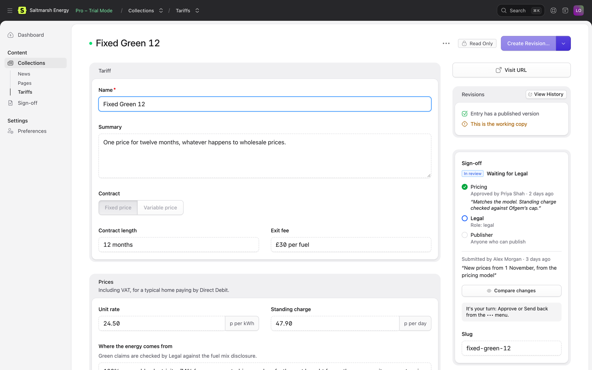
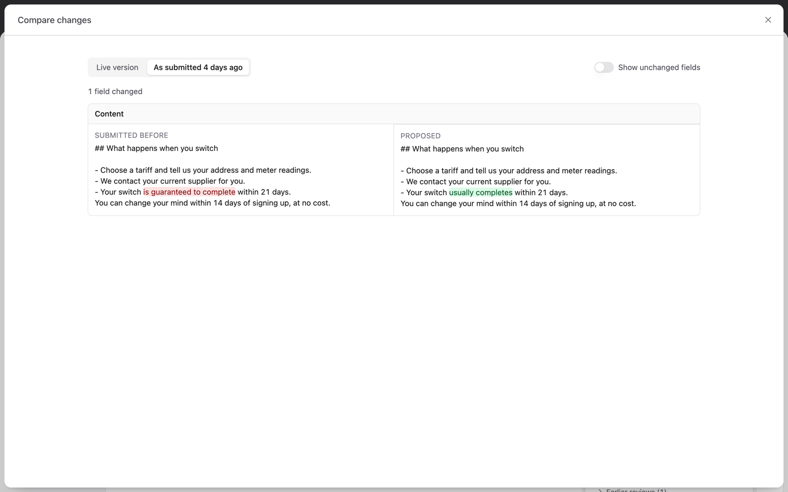
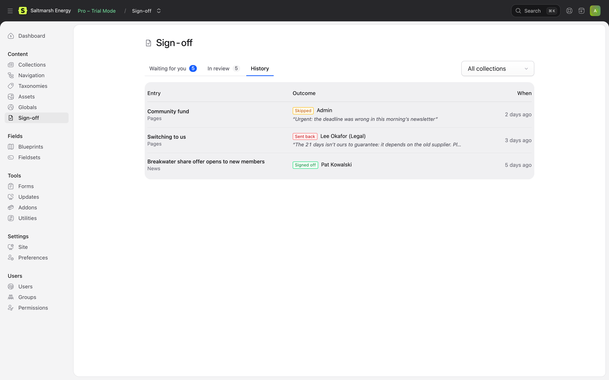
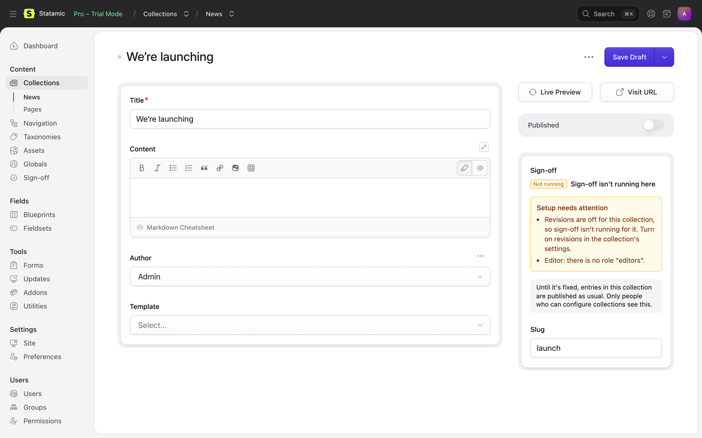

# The Control Panel

## The Sign-off panel

Entries in collections with steps get a **Sign-off** panel at the top of their sidebar. It's worked out fresh each time the entry is opened, and isn't saved with the entry.



It shows:

- where the entry is: not submitted yet, waiting for a step, sent back, signed off;
- each step, who approved it and when, with their comment, and who can approve the steps still to come;
- who submitted it, when, and their note;
- why it was sent back, in red, until it's submitted again;
- what the person looking at it can do next ("It's your turn: Approve or Send back from the ••• menu");
- **Compare changes**;
- earlier rounds of review, under *Earlier reviews*.

## The actions

Everything happens from the entry's ••• menu. Each person sees only what they can do right now.

| Action | Who | |
| --- | --- | --- |
| **Submit for sign-off** | People who can edit the entry, when it has changes to review | With an optional note for the reviewers |
| **Approve** | The current step's approvers | With an optional comment. At the last step it reads **Approve and publish** |
| **Send back** | The current step's approvers | With a reason, which is required |
| **Withdraw from review** | The person who submitted it, and super users | Approvals so far are lost |

After an action, the entry reloads so the lock and the panel are up to date.

Save before submitting: only saved changes are sent.

## Comparing changes

**Compare changes** in the panel shows each changed field side by side, with the words that differ highlighted. It's there whenever there's something to compare.


Compare with:

- **the live version**, for a published entry. For an entry that was never published, every field is new;
- **what was submitted last time**, once an entry has been through a round of review. After it's sent back, the author can check their changes before submitting again, and reviewers see exactly what changed since they last looked.



**Images and files** in assets fields, and images in Bard, show as thumbnails, outlined green when added and red when removed, with their alt text. Click one to see it full size, next to the image it replaces; ← and → move between the changed images, and Escape closes it. Reviewers can see an entry's images even without access to its asset container, but only the files the entry uses. An image replaced by a file with the same name doesn't show as a change, since the entry itself is unchanged.

Other values are shown as people know them: rich text (Bard) as paragraphs, with headings, lists and sets marked; linked entries, terms and users by name; options by their labels; toggles as Yes or No. Anything else is shown as YAML. **Show unchanged fields** shows the rest of the entry too.

## Content → Sign-off

Everyone who can view entries in a collection with steps gets **Sign-off** under Content.


- **Waiting for you**: entries whose current step you can approve, the longest waiting first. **Review** opens the entry.
- **In review**: everything in review that you can see, with the step it's waiting for and who submitted it.
- **History**: every finished round, newest first: signed off, sent back (with the reason), withdrawn, needing resubmitting, or published without sign-off.



With more than one collection, you can show one at a time. Entries that have been deleted leave the first two lists, and stay in the history.

## The dashboard widget

```php
// config/statamic/cp.php
'widgets' => [
    ['type' => 'sign_off', 'width' => 50],
],
```


It shows each person:

- **Waiting for you**: entries waiting for their review, with how long each has waited;
- **Sent back to you**: their entries that were sent back, with the reason, until they submit them again;
- **Yours in review**: their entries in review, and the step each is waiting for.

| Option | Default | |
| --- | --- | --- |
| `title` | Sign-off | The widget's heading |
| `limit` | 5 | Entries in each list |

People who can't see entries in any collection with steps don't see the widget.

## Setup problems

People who can configure collections (and super users) are told when sign-off's setup has a problem: a collection without revisions, a step without a handle, a role that doesn't exist. They see it at the top of Content → Sign-off, and in the panel of entries where sign-off isn't running and why.



Run `php please sign-off:check` to see the same from the command line. See [Troubleshooting](troubleshooting.md).

## Settings

Tools → Addons → Sign-off → Settings sets which collections need sign-off and their steps, the rules, and email, for super users and roles with the *Sign-off settings* permission. See [Configuration](configuration.md#in-the-control-panel).

## Permissions

Sign-off uses Statamic's own permissions, plus one of its own:

| Permission | |
| --- | --- |
| **Publish entries without sign-off** | Under *Sign-off* in a role's permissions. Publish as Statamic normally allows, without the steps. It's recorded in the entry's sign-off history. |
| **Sign-off settings** | Under *Addons*. Change the steps, the rules and email in the Control Panel. |

Who can submit, approve and see what is covered in [How sign-off works](how-it-works.md) and [Configuration](configuration.md#who-can-approve-a-step).
