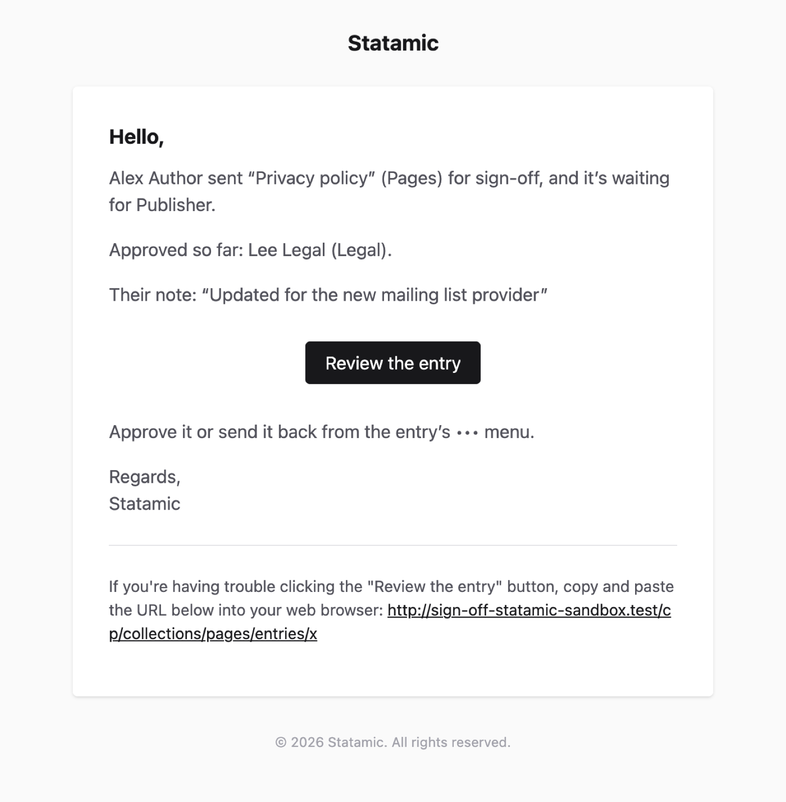

# Emails

Sign-off emails people when there's something for them to do, or something they'll want to know.

| When | Who | Subject |
| --- | --- | --- |
| An entry is submitted, or approved and moves on to the next step | Everyone who can approve that step | Waiting for your review: *title* |
| A reviewer sends it back | The person who submitted it | Sent back: *title* |
| The last step approves it | The person who submitted it | Signed off and published: *title* |



Each email links straight to the entry. The review request includes the author's note and who has approved so far; the sent-back email includes the reason.

## Who isn't emailed

- Nobody is emailed about something they did themselves.
- The person who submitted an entry isn't asked to review it (unless `self_approval` is on).
- Super users are only asked to review a step when nobody else can approve it.
- Users without an email address.

Withdrawals, and approvals before the last step, don't send emails to the author: the entry's panel and the dashboard widget show where it is.

## Sending

Emails use your site's mail settings (`MAIL_MAILER` and so on in `.env`) and Laravel's standard email layout, with your app name.

They're queued, so with a queue worker running they're sent in the background, and the Control Panel doesn't wait for your mail server. Without one (`QUEUE_CONNECTION=sync`), they're sent straight away.

If an email can't be sent, the error is logged, and the review carries on.

## Turning them off

```env
SIGN_OFF_MAIL=false
```

## Other channels

For Slack, Teams or anything else, turn email off (or leave it on) and listen for Sign-off's [events](php-api.md#events): each one has the entry, the submission and the person who acted.

```php
use Illuminate\Support\Facades\Event;
use NineteenNinetyFour\SignOff\Events\EntryRejected;

Event::listen(EntryRejected::class, function (EntryRejected $event) {
    // $event->entry, $event->submission, $event->user, $event->step, $event->reason
});
```

## Changing the wording

The emails are Laravel notifications in `NineteenNinetyFour\SignOff\Notifications`. Their text can be changed through translations: add the English sentence as a key in your site's `lang/en.json` (or the language your Control Panel uses), with the wording you want.

```json
{
    "Approve it or send it back from the entry’s ••• menu.": "Open the entry, then use Approve or Send back."
}
```
